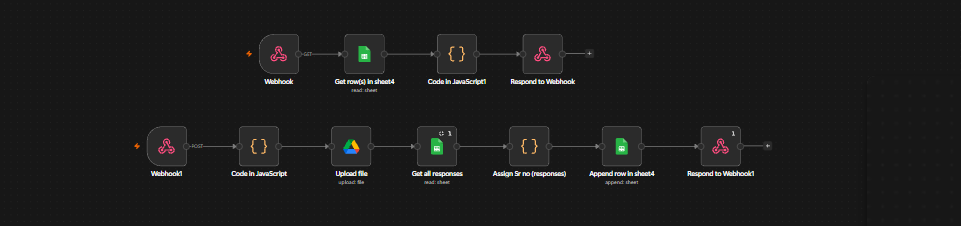
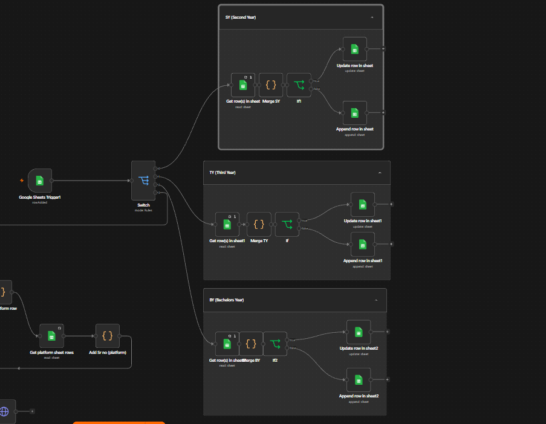
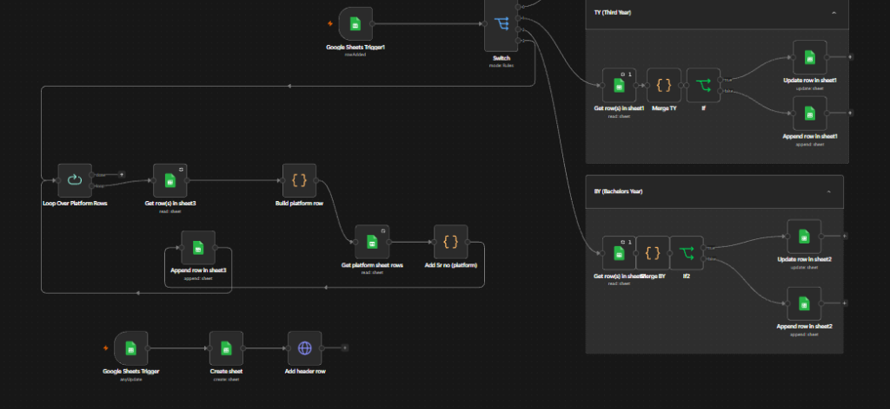

# 🎓 Certificate Tracker & Verification System

[](https://slate.zoho.com)
[](https://n8n.io)
[](https://aws.amazon.com/ec2/)
[](https://www.duckdns.org)
[](https://drive.google.com)

Automated academic certification portal built for the **Department of Artificial Intelligence & Data Science, SNJB's KBJ COE**. Features resilient batch file uploads, automated student record indexing, and dynamic Google Sheets & Drive synchronization powered by **n8n**.

---

## ⚡ Architecture & Deployment Overview

| Layer | Technology | Deployment & Configuration |
|---|---|---|
| **Frontend UI** | HTML5, CSS3, Vanilla JS | Hosted on **Zoho Slate** |
| **Automation Agent** | **n8n** (v1.x, Self-Hosted) | **AWS EC2** running via **Docker Container** |
| **Networking & DNS** | AWS Elastic IP + DuckDNS | `https://snjbcoe.duckdns.org` with SSL termination |
| **File Storage** | Google Drive API | Auto-uploads to `AIDS_Certification` directory |
| **Database & Records** | Google Sheets API | Auto-routes into class & platform-specific tabs |

---

## 🔄 Complete Workflow Architecture

The automation engine operates in **two coordinated tiers**: real-time Webhook handling and asynchronous Google Sheets triggers.

```
[Student / Zoho Slate Frontend]
        │
        ├── (GET /webhook)  ──► Fetch Unique Platforms from "Certifications" Sheet
        │
        └── (POST /webhook) ──► Upload Files to Google Drive ──► Append to "responses" Sheet
                                                                         │
                                                                   [Sheets Trigger]
                                                                         │
                         ┌───────────────────────────────────────────────┴──────────────────────────────┐
                         ▼                                                                              ▼
               [Academic Year Switch]                                                         [Platform Loop]
    ┌────────────────────┼────────────────────┐                                                         │
    ▼                    ▼                    ▼                                                         ▼
[SY Pipeline]        [TY Pipeline]        [BY Pipeline]                                    [Append to Platform Tab]
(Update / Append)    (Update / Append)    (Update / Append)                                (Coursera, NPTEL, etc.)
```

---

## 📸 Workflow Breakdown & Visuals

### 1. Ingestion & Webhook Endpoints
Handles real-time communication between the Zoho Slate client and backend storage.

<p align="center">
  
</p>

| Pipeline | Trigger / Method | Operations |
|---|---|---|
| **Platform Loader** | `GET /webhook/...` | Reads `Certifications` sheet ➔ Deduplicates platform names in JS ➔ Returns JSON `{ options: [...] }` |
| **Submission Ingestion** | `POST /webhook/...` | Parses `multipart/form-data` (1–10 certs) ➔ Uploads to Google Drive (`[Roll]_[Idx]_[File]`) ➔ Computes Sr. No. ➔ Logs to `responses` sheet |

---

### 2. Academic Year Branching (SY / TY / BY)
Automatically maintains student certification counts without duplicate entries.

<p align="center">
  
</p>

| Academic Year | Switch Rule | Existing Student (`found == true`) | New Student (`found == false`) |
|---|---|---|---|
| **SY (Second Year)** | `Academic Year == "SY (Second Year)"` | Increments `Certificate Count` | Appends new row with `Sr.No.`, `Roll no.`, `Name` |
| **TY (Third Year)** | `Academic Year == "TY (Third Year)"` | Increments `Certificate Count` | Appends new row with `Sr.No.`, `Roll no.`, `Name` |
| **BY (Final Year)** | `Academic Year == "BY (Final Year)"` | Increments `Certificate Count` | Appends new row with `Sr.No.`, `Roll no.`, `Name` |

---

### 3. Platform Distribution & Dynamic Sheet Creator
Sorts certificates into dedicated platform-wise records and creates new tabs on the fly.

<p align="center">
  
</p>

| Step | Node Name | Action Performed |
|---|---|---|
| **1. Batch Splitter** | `Loop Over Platform Rows` | Processes each incoming submission one-by-one (`batchSize: 1`) |
| **2. Target Lookup** | `Get platform sheet rows` | Identifies existing records in the corresponding platform sheet tab |
| **3. Indexing** | `Add Sr no (platform)` | Automatically assigns next sequential serial number |
| **4. Append** | `Append row in sheet3` | Logs Student Name, Title, Issue Date, Agency, and Drive Link |
| **5. Auto-Tab Creator** | `Google Sheets Trigger` ➔ `Create sheet` | Detects newly added platforms and dynamically generates new tabs |

---

## 🛠️ Frontend Features ([index.html](index.html))

| Feature | Mechanism | Benefit |
|---|---|---|
| **Anti-Crash Storage** | `IndexedDB` (`certPortalFiles`) | Restores chosen file blobs if mobile browser reloads during file picker selection |
| **Draft Auto-Save** | `localStorage` (`certPortalDraft_v1`) | Retains student name, roll number, and selections across refreshes (6h TTL) |
| **Dynamic Form** | Pure JavaScript DOM | Dynamically expands 1–10 certificate card blocks on demand |
| **Payload Guard** | Client-side Byte Counter | Blocks uploads exceeding 50 MB before hitting network thresholds |
| **Fail-Safe Uploads** | `ArrayBuffer` Memory Copy | Protects against detached cloud-storage file pointers (Google Drive/OneDrive) |

---

## 📋 Google Sheets Schema Reference

### `responses` Tab (Master Raw Log)
| Col A | Col B | Col C | Col D | Col E | Col F | Col G | Col H |
|---|---|---|---|---|---|---|---|
| **Sr no.** | **Student Name** | **Roll No.** | **Academic Year** | **Platform** | **Course Title** | **Date** | **Drive Link** |

### `SY` / `TY` / `BY` Tabs (Roster Count)
| Sr.No. | Roll no. | Name | Certificate Count |
|---|---|---|---|
| `1` | `45` | `Rohit Sharma` | `3` |

### Platform Tabs (e.g. `Coursera`, `NPTEL`, `Udemy`)
| Sr. no. | Name of Student | Title | Date of Certification | Types | Authorize Agency | Link |
|---|---|---|---|---|---|---|

---

## 🚀 Quick Setup & Configuration

1. **Configure Webhook Endpoints in `index.html`**:
   ```javascript
   const N8N_BASE_URL = "https://snjbcoe.duckdns.org";
   const PLATFORM_OPTIONS_WEBHOOK_URL = N8N_BASE_URL + "/webhook/616164fa-f480-4486-97a7-b9a41421032c";
   const FORM_SUBMIT_WEBHOOK_URL = N8N_BASE_URL + "/webhook/64b07f1a-e0c3-4714-9711-05b466dd07ae";
   ```

2. **Run n8n on AWS EC2 (Docker Compose)**:
   ```yaml
   services:
     n8n:
       image: docker.n8n.io/n8nio/n8n
       restart: always
       ports:
         - "5678:5678"
       environment:
         - N8N_HOST=snjbcoe.duckdns.org
         - N8N_PORT=5678
         - N8N_PROTOCOL=https
         - WEBHOOK_URL=https://snjbcoe.duckdns.org/
   ```

3. **Deploy Frontend**:
   Upload `index.html` directly to **Zoho Slate**.

---

<p align="center">
  <b>Department of Artificial Intelligence & Data Science</b><br>
  SNJB's KBJ College of Engineering, Chandwad • Developed by <a href="https://github.com/ssarkan07">Arkan Shaikh</a>
</p>